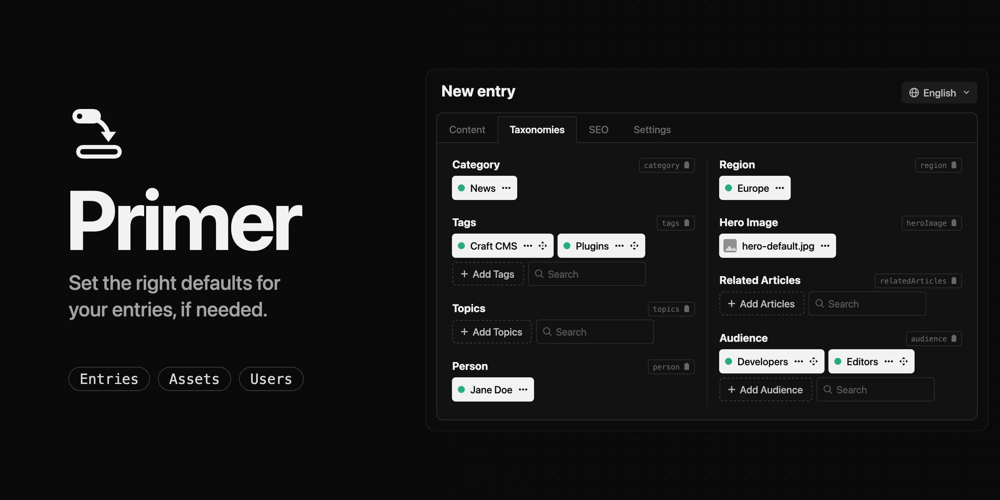
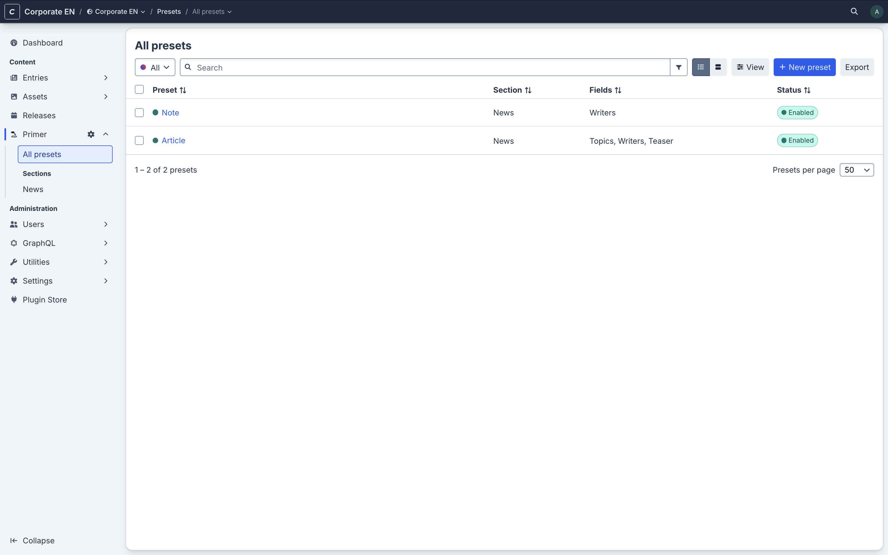
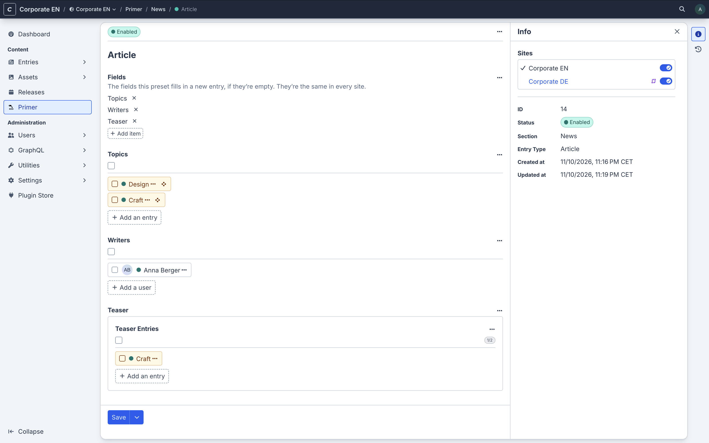

# Primer

Set the right defaults for your entries, if needed. Primer holds presets for the relation fields of new entries in Craft CMS. An editor creates a *News › Article*, and its Topics, Authors and Hero Image fields already hold what the site usually wants there. Primer fills them once, when the entry is created, writes only into empty fields, and never touches the entry again.



## How it works

- **Presets per section and entry type.** A preset belongs to one entry type in one section. You pick which of the entry type's relation fields it holds (Entries, Assets and Users fields) and fill them in Craft's own fields, in Craft's own element editor, the way you would on an entry.
- **Across sites, like an entry.** A preset spans the sites a new entry of its section would be saved to: every site with *All* propagation, the site group or language with *Site group* or *Language*, one site with *None*. Its values propagate and translate exactly as the entry's do, because they are the same fields. Each site can switch the preset on or off. A site has one preset per entry type: after a site is added to a section, or its propagation method changes, a new preset spans only the sites no preset holds yet.
- **Once, into empty fields.** When an entry is created, or switches entry type, Primer looks up the preset for its section, entry type and site and copies its elements into the fields that are still empty. A field that already holds something is left alone, and a field with a maximum gets no more than that. After that the entry is the editor's. It works wherever entries are created: the control panel, slideouts, the console, migrations, Feed Me and other imports.
- **Content Blocks.** A Content Block field whose layout holds relation fields can go into a preset as a whole. Inside the preset it shows only those relation fields, and each one fills the entry's block if it's empty there; the block's other values stay.



## Requirements

Craft CMS 6.0.0-beta.1 or later, PHP 8.5 or later. Several sites need Craft Pro; on a single site Primer works with any edition. For Craft CMS 5, use Primer 1.x.

## Installation

From the Plugin Store: search for “Primer” and press *Install*.

With Composer:

```bash
composer require davidhellmann/craft-primer
php artisan craft:plugin/install primer
```

## Usage

Primer's section of the control panel is Craft's own element index and element editor, for presets:

- **Index**: the presets of the current site, with their section, fields and status. *All presets* lists every one; each section has a source of its own. Craft's actions switch presets on or off and delete them.
- **New preset**: starts a preset in the section the index shows, with an entry type that has no preset there yet. Until it's created, you can pick another section and entry type.
- **Preset**: *Fields* lists the fields the preset holds, with *Add item* to add one of the entry type's relation fields and a × to remove one. The chosen fields follow, filled like on an entry. The sidebar has the preset's status in each site it spans.

Presets open as a page or in a slideout, like entries. Every screen is about one site, picked with Craft's site menu at the top.

Users need the *Access Primer* permission. Saving or deleting a preset in a site also needs permission to edit that site, and only that one. As with Craft's entries, what a preset shares across its scopes reaches sites the user can't edit: the choice of fields, a field taken out of it being emptied, and deleting the preset in every scope.

Presets are content, not project config: set them up in each environment. They work with `allowAdminChanges` off. Uninstalling Primer deletes every preset.

## Upgrading from Primer 1.x

Upgrade the project to Craft 6, then require Primer 2. Primer 2 keeps Primer 1's table, element type and schema version, so presets, their fields, values and statuses carry over as they are.

## Good to know

Primer fills a new entry once, and only its empty fields. That has a few consequences:

- A field the editor clears stays clear. Primer doesn't fill it again on the next save.
- When an entry switches entry type, the values Craft carries over stay, and only the fields left empty get the new type's preset. A field the editor emptied before switching gets it too. Switching from A to B, back to A and to B again applies B's preset each time.
- With autosave on (Craft's default), the preset shows as soon as the editor switches the type. With `autosaveDrafts` off, it lands on the next save.
- Existing entries aren't filled. Primer acts when an entry is created or switches type, never afterwards.
- Primer fills the site an entry is saved in. Craft then propagates the entry to its other sites, as always; a site enabled later gets what Craft copies, not a preset.

**Logging.** Each entry Primer fills gets one info line in Craft's log, naming the fields. A preset that can't be applied never stops the entry's save: Primer logs a warning and the entry saves without it.

**Custom propagation.** In a section with *Custom* propagation, a preset spans only the site it was made in, so every site needs its own. The control panel doesn't say so.

**Not covered.** Entries nested in Matrix or CKEditor fields; Content Blocks inside Content Blocks. A preset holds fields placed directly in the entry type's layout, and Content Blocks one level deep.

## License

Primer is a commercial plugin under the [Craft License](LICENSE.md). It's free to try in development environments; a production site needs a license from the Plugin Store.
