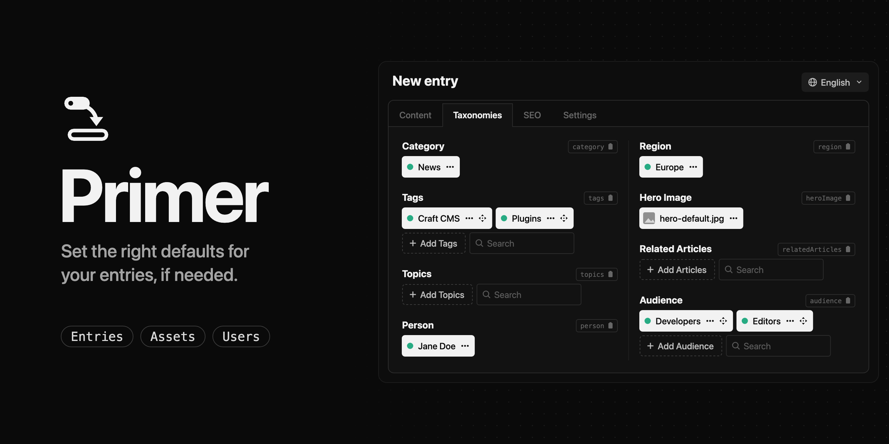
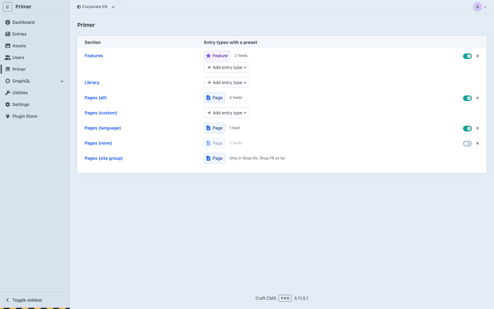
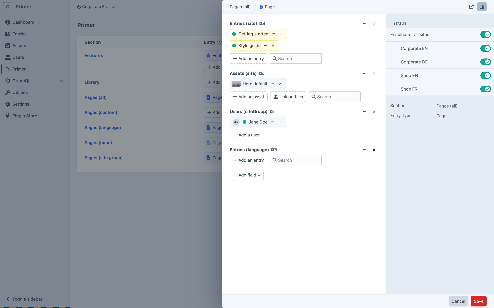

# Primer

Presets for the relation fields of new entries in Craft CMS. An editor creates a *News › Article*, and its Topics, Authors and Hero Image fields already hold what the site usually wants there. Primer fills them once, when the entry is created, writes only into empty fields, and never touches the entry again.



## How it works

- **Presets per section and entry type.** A preset belongs to one entry type in one section. You pick which of the entry type's relation fields it holds (Entries, Assets and Users fields) and fill them in Craft's own fields, the way you would on an entry.
- **Across sites, like an entry.** A preset spans the sites a new entry of its section would be saved to: every site with *All* propagation, the site group or language with *Site group* or *Language*, one site with *None*. Its values propagate and translate exactly as the entry's do, because they are the same fields. Each site can switch the preset on or off.
- **Once, into empty fields.** When an entry is created, or switches entry type, Primer looks up the preset for its section, entry type and site and copies its elements into the fields that are still empty. A field that already holds something is left alone, and a field with a maximum gets no more than that. After that the entry is the editor's. It works wherever entries are created: the control panel, slideouts, the console, migrations, Feed Me and other imports.
- **Content Blocks.** A Content Block field whose layout holds relation fields can go into a preset as a whole. Inside the preset it shows only those relation fields, and each one fills the entry's block if it's empty there; the block's other values stay.



## Requirements

Craft CMS 5.11.5 or later, PHP 8.2 or later. Several sites need Craft Pro; on a single site Primer works with any edition.

## Installation

From the Plugin Store: search for “Primer” and press *Install*.

With Composer:

```bash
composer require davidhellmann/craft-primer
php craft plugin/install primer
```

## Usage

Primer adds its own section to the control panel, with three screens:

- **Index**: every section of the current site, with its entry types that have a preset. Each line shows the entry type, how many fields its preset holds, a switch that turns the preset on or off for this site, and a × to delete it. *+ Add entry type* starts a preset for another one.
- **Section page**: the section's entry types, each with the fields of its preset, or *+ Add preset*.
- **Preset**: the chosen fields, filled like on an entry. *+ Add field* adds one, the × in its heading removes it. The sidebar has the preset's status for each site it spans.

A click on a section or entry type opens its page, a double-click opens the same screen in a slideout over the one you're on. Cmd/Ctrl-click opens it in a new tab. Every screen is about one site, picked with Craft's site menu at the top.

Users need the *Access Primer* permission. Saving, switching or deleting a preset in a site also needs permission to edit that site.

Presets are content, not project config: set them up in each environment. They work with `allowAdminChanges` off. Uninstalling Primer deletes every preset.

## Good to know

Primer fills a new entry once, and only its empty fields. That has a few consequences:

- A field the editor clears stays clear. Primer doesn't fill it again on the next save.
- When an entry switches entry type, the values Craft carries over stay, and only the fields left empty get the new type's preset. A field the editor emptied before switching gets it too. Switching from A to B, back to A and to B again applies B's preset each time.
- With autosave on (Craft's default), the preset shows as soon as the editor switches the type. With `autosaveDrafts` off, it lands on the next save.
- Existing entries aren't filled. Primer acts when an entry is created or switches type, never afterwards.
- Primer fills the site an entry is saved in. Craft then propagates the entry to its other sites, as always; a site enabled later gets what Craft copies, not a preset.

**Custom propagation.** In a section with *Custom* propagation, a preset spans only the site it was made in, so every site needs its own. The control panel doesn't say so.

**Not covered.** Categories and Tags fields; entries nested in Matrix or CKEditor fields; Content Blocks inside Content Blocks. A preset holds fields placed directly in the entry type's layout, and Content Blocks one level deep.

## Local development

Point a Craft project at a local copy with a path repository in its `composer.json`:

```json
{
    "minimum-stability": "dev",
    "prefer-stable": true,
    "repositories": [
        { "type": "path", "url": "../craft-primer" }
    ]
}
```

Then `composer require davidhellmann/craft-primer` and `php craft plugin/install primer`. In the plugin folder:

- `composer check-cs` and `composer phpstan` run the checks.
- `composer test` runs the PHP tests with Codeception: the `unit` suite without Craft, then the `integration` and `multisite` suites, which install Craft into a test database from the fixtures in `tests/fixtures/solo` (one site) and `tests/fixtures/pro` (four sites in two site groups). Copy `tests/.env.example` to `tests/.env` and point it at an empty MySQL or Postgres database; every table in it is dropped. `composer test -- unit` needs no database.
- `npm ci`, then `npm test`, runs the browser tests with Playwright. They install their own Craft from the Pro fixture into the database in `tests/browser/.env` (copy `tests/browser/.env.example`), serve it with `php craft serve` and click through the control panel.

The CI workflow runs all of them, the integration suites on MySQL and Postgres with the lowest and the latest supported Craft. Before a release, go through [the release checklist](docs/release-checklist.md).

## License

Primer is a commercial plugin under the [Craft License](LICENSE.md). It's free to try in development environments; a production site needs a license from the Plugin Store.
